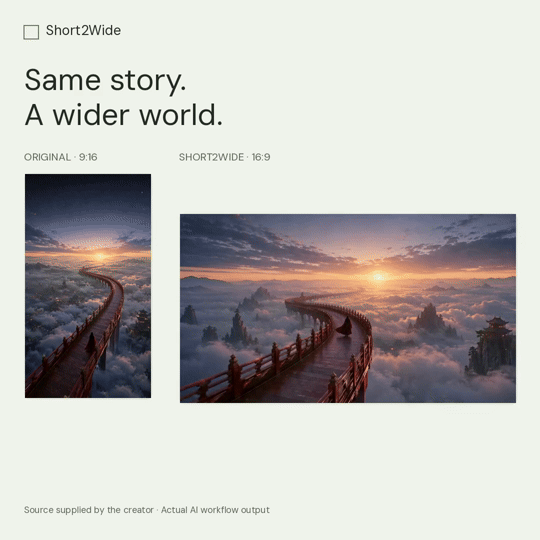
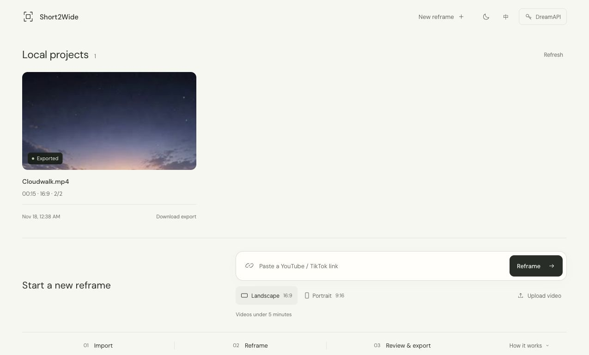

# Short2Wide

**English** · [简体中文](README.zh-CN.md)

A local workspace for reframing short videos with **DreamAPI Seedance 2.5**. Import a video under five minutes, generate in segments, compare both sides, and export with the original soundtrack.

[](docs/assets/short2wide-en.mp4)

[Watch the 20-second film](docs/assets/short2wide-en.mp4) · [Workflow and limitations](docs/showcase.md)

> Bring your own DreamAPI key. The application runs locally; generation uploads reference segments to a paid cloud service. The model can reject media or produce imperfect text, motion and timing.

## A short path from source to export

1. **Import** — paste a public YouTube/TikTok URL or upload a local video under five minutes and 512 MB. Choose 16:9 or 9:16.
2. **Generate** — split on scene changes and audio pauses, then generate the segments you choose. Upload, generation and local alignment have distinct animated states and elapsed time.
3. **Compare** — play, pause and seek either video independently. **Play in sync** restarts both at the selected segment's beginning.
4. **Export** — once every segment has a result, click **Confirm all & export** once. There is no per-segment approval checklist.


Optional two-cue timing correction and model-audio generation are folded into **Advanced options**. Disabling model audio still preserves the source soundtrack in the local preview and final export.

## Local projects come first

The homepage displays existing projects with recognizable thumbnails, generation progress and export status. Open a card to continue, or download an existing export directly. Returning to the homepage refreshes the list.



## Install and run

Requires Python **3.10+**, FFmpeg/ffprobe, and Node **22+ only for JavaScript regression tests**.

```sh
git clone https://github.com/Hy-1990/Short2Wide.git
cd Short2Wide
python3 -m venv .venv
source .venv/bin/activate
python -m pip install -r requirements.txt
python -B server.py --port 4178
```

On Windows, activate with `.venv\Scripts\activate` and use `python` instead of `python3`. Install FFmpeg separately and ensure `ffmpeg` and `ffprobe` are on PATH. `yt-dlp` is installed by the requirements file.

Open **http://127.0.0.1:4178/**. Configure the key through **DreamAPI** in the top right. Light/dark/system appearance and Chinese/English preferences persist across routes.

The DreamAPI adapter is bundled in `scripts/dreamapi.py`; no agent skill or external AI coding environment is required. Use `server.py`, not a static file server.

## Data and recovery

- The service listens on **127.0.0.1 only**, validates Host/Origin, and serves an explicit public-file allowlist.
- Keys are stored outside the repository at `~/.config/reframe-studio/dreamapi.json`, with 0600 permissions. The app never persists them in browser storage or returns a saved key through its API.
- Projects remain at `~/.local/share/reframe-studio/projects/` to preserve compatibility with the original local prototype.
- Uploading from the homepage transfers the file only to the local app. Clicking Generate uploads the reference segment to DreamAPI and may incur charges.
- Task IDs are persisted. A timed-out query resumes the **same task**, never silently submits another. Ambiguous submissions without an ID stop for manual verification. New attempts preserve prior task information.
- Failed local alignment preserves the previously playable result. Source and model-generated files are kept separately from local audio previews and exports.

## Practical limits

- No restriction on language, person count, speech or silent footage is imposed by the app. Provider restrictions still apply, including restrictions on real-person references.
- Segmentation uses scene changes and pauses, not semantic understanding. Generated text, faces, motion and lip sync need review.
- Default alignment scales overall duration. Two-cue correction adjusts one linear offset/speed relationship; it cannot guarantee every intermediate event matches.
- Export always takes audio from the original file and encodes it as AAC for MP4 compatibility. Silent inputs remain silent.
- YouTube/TikTok availability, authentication, regional restrictions and extractor changes can affect downloading. Local files remain an alternative.
- Output-audio rejection is distinct from rejection of the uploaded video. You can turn model-audio generation off under Advanced options before an explicitly chosen retry.

## Verification

```sh
node --test test_playback.mjs
python -B -m unittest -q test_pipeline.py test_server.py test_provider.py
```

Tests use temporary media, stub provider responses and an isolated local server; they do not submit paid generation tasks. They cover independent playback, sync restarts, one-click export, original-audio previews/exports, history metadata, alignment recovery, uncertain task responses and credential boundaries. See [verification notes](docs/verification.md).

## License and media

Application code: [MIT](LICENSE). Fonts, hosted services and showcase-media rights: [third-party notices](THIRD-PARTY.md).
