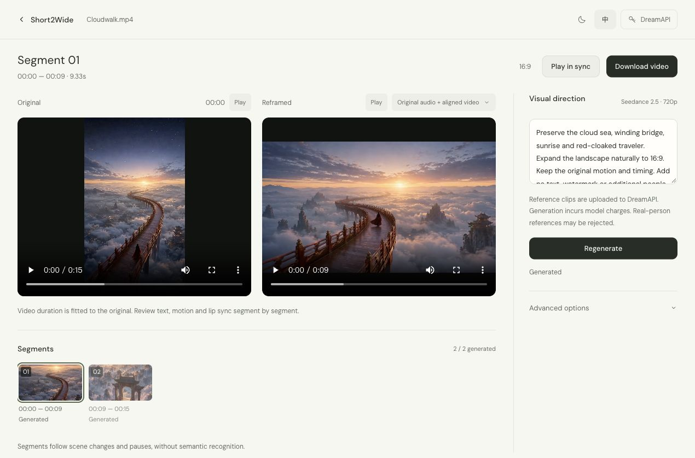

# Short2Wide

**English** · [简体中文](README.zh-CN.md)

A local workspace for reframing short videos with **DreamAPI Seedance 2.5**. Import a video under five minutes, generate in segments, compare both sides, and export with the original soundtrack.

https://github.com/user-attachments/assets/b2b6c053-876b-4c61-84b5-139c0d3430ad

[Download the 20-second film · 30 fps](docs/assets/short2wide-en.mp4) · [Workflow and limitations](docs/showcase.md)

> Bring your own DreamAPI key. The application runs locally; generation uploads reference segments to a paid cloud service. The model can reject media or produce imperfect text, motion and timing.

## A short path from source to export

1. **Import** — paste a public YouTube/TikTok URL or upload a local video under five minutes and 512 MB. Choose 16:9 or 9:16.
2. **Generate** — split on scene changes and audio pauses, then generate the segments you choose. Upload, generation and local alignment have distinct animated states and elapsed time.
3. **Compare** — play, pause and seek either video independently. **Play in sync** restarts both at the selected segment's beginning.
4. **Export** — once every segment has a result, click **Confirm all & export** once. There is no per-segment approval checklist.



Optional two-cue timing correction and model-audio generation are folded into **Advanced options**. Disabling model audio still preserves the source soundtrack in the local preview and final export.

## Home and project library

The left sidebar separates **Home** from **Projects**. Home offers video import and the six most recent projects. Projects shows the complete library with name search and exported/unfinished filters. Cards wrap into additional rows as the library grows; the project count stays visible in navigation. Open a card to continue, or download a completed export directly.

**New reframe** returns to and focuses the import field. **How to use** opens a separate guide; the old decorative workflow footer is removed. On phones, navigation moves to a compact top area. Theme, language and DreamAPI controls remain available.


## Install and run

Use your existing **Python 3.10+** and pip. The only direct Python packages are `requests` and `yt-dlp`. No environment creation or activation is required.

### Windows 10/11

1. Install [Python](https://www.python.org/downloads/windows/) and [FFmpeg](https://www.gyan.dev/ffmpeg/builds/). With WinGet, you can use:

   ```powershell
   winget install --id Python.Python.3.12 -e
   winget install --id Gyan.FFmpeg -e
   ```

   Reopen PowerShell after installing. Check `python --version`, `ffmpeg -version` and `ffprobe -version`. If Python is available only as `py`, use `py -3` instead of `python` below.

2. Download this repository through **Code → Download ZIP** and extract it, or clone it with Git. Open PowerShell in the extracted project folder and install the packages once:

   ```powershell
   python -m pip install -r requirements.txt
   ```

3. Start from PowerShell:

   ```powershell
   .\start.bat
   ```

   Or double-click `start.bat` in File Explorer. In Command Prompt, run `start.bat`. The launcher checks dependencies, supports paths with spaces and Chinese characters, and prints the access URL. An error remains visible for double-click launches. No WSL, Bash or PowerShell execution-policy change is needed.

If you installed FFmpeg manually, add its **bin** folder (containing `ffmpeg.exe` and `ffprobe.exe`) to your user PATH and reopen the terminal. Optional port: `.\start.bat --port 4179`.

### macOS / Linux

Install Python 3.10+ and FFmpeg first. On macOS with Homebrew: `brew install python ffmpeg`. On Linux, install Python, pip and FFmpeg using your distribution's package manager.

```sh
git clone https://github.com/Hy-1990/Short2Wide.git
cd Short2Wide
python3 -m pip install -r requirements.txt
bash start.sh
```

If pip reports `externally-managed-environment`, use a user-directory installation:

```sh
python3 -m pip install --user --break-system-packages -r requirements.txt
```

These [pip options](https://pip.pypa.io/en/stable/cli/pip_install/) do not change pip configuration. For another port: `bash start.sh --port 4179`.

With conda active, the script checks the current Python first, then existing Homebrew Python locations if dependencies are missing. It selects an interpreter with the required packages and prints `Using Python: ...`. It does not modify or switch your conda environment or automatically install packages.

### Open and use

Both launchers print the actual address after startup:

```text
Short2Wide
  访问 / Open: http://127.0.0.1:4178/
  按 Ctrl+C 停止 / Press Ctrl+C to stop.
```

Open [http://127.0.0.1:4178/](http://127.0.0.1:4178/), configure your key through **DreamAPI** in the top right, then import a link or file. Generate and review the segments, then click **Confirm all & export**.

Keep the terminal open. Press `Ctrl+C` to stop; if Command Prompt asks whether to terminate the batch job, enter `Y`. Next time, just run the launcher for your platform. If the port is occupied, stop the earlier server or choose another port.

The DreamAPI adapter is bundled; no agent skill, AI coding environment or Node installation is needed for normal use.

## Data and recovery

- The service listens on **127.0.0.1 only**, validates Host/Origin, and serves an explicit public-file allowlist.
- Keys are stored outside the repository at `~/.config/reframe-studio/dreamapi.json`, with 0600 permissions on macOS/Linux; Windows uses the permissions inherited from your user-profile directory. The app never persists them in browser storage or returns a saved key through its API.
- On Windows, `~` means your user-profile folder: credentials are at `%USERPROFILE%\.config\reframe-studio\dreamapi.json`; projects are at `%USERPROFILE%\.local\share\reframe-studio\projects\`.
- Projects remain at `~/.local/share/reframe-studio/projects/` to preserve compatibility with the original local prototype.
- Uploading from the homepage transfers the file only to the local app. Clicking Generate uploads the reference segment to DreamAPI and may incur charges.
- Task IDs are persisted. A timed-out query resumes the **same task**, never silently submits another. Ambiguous submissions without an ID stop for manual verification. New attempts preserve prior task information.
- Failed local alignment preserves the previously playable result. Source and model-generated files are kept separately from local audio previews and exports.

## Practical limits

- No restriction on language, person count, speech or silent footage is imposed by the app. Provider restrictions still apply, including restrictions on real-person references.
- Segmentation uses scene changes and pauses, not semantic understanding. Generated text, faces, motion and lip sync need review.
- Default alignment scales overall duration. Two-cue correction adjusts one linear offset/speed relationship; it cannot guarantee every intermediate event matches.
- Export always takes audio from the original file and encodes it as AAC for MP4 compatibility. Silent inputs remain silent.
- YouTube/TikTok availability, authentication, regional restrictions and extractor changes can affect downloading. Local files remain an alternative.
- Output-audio rejection is distinct from rejection of the uploaded video. You can turn model-audio generation off under Advanced options before an explicitly chosen retry.

## Verification

Node 22+ is needed only for JavaScript tests.

```sh
node --test tests/test_playback.mjs
python -B -m unittest discover -s tests -t . -q
```

Tests use temporary media, stub provider responses and an isolated local server; they do not submit paid generation tasks. They cover independent playback, sync restarts, one-click export, original-audio previews/exports, history metadata, alignment recovery, uncertain task responses and credential boundaries. See [verification notes](docs/verification.md).

## License and media

Application code: [MIT](LICENSE). Fonts, hosted services and showcase-media rights: [third-party notices](THIRD-PARTY.md).
