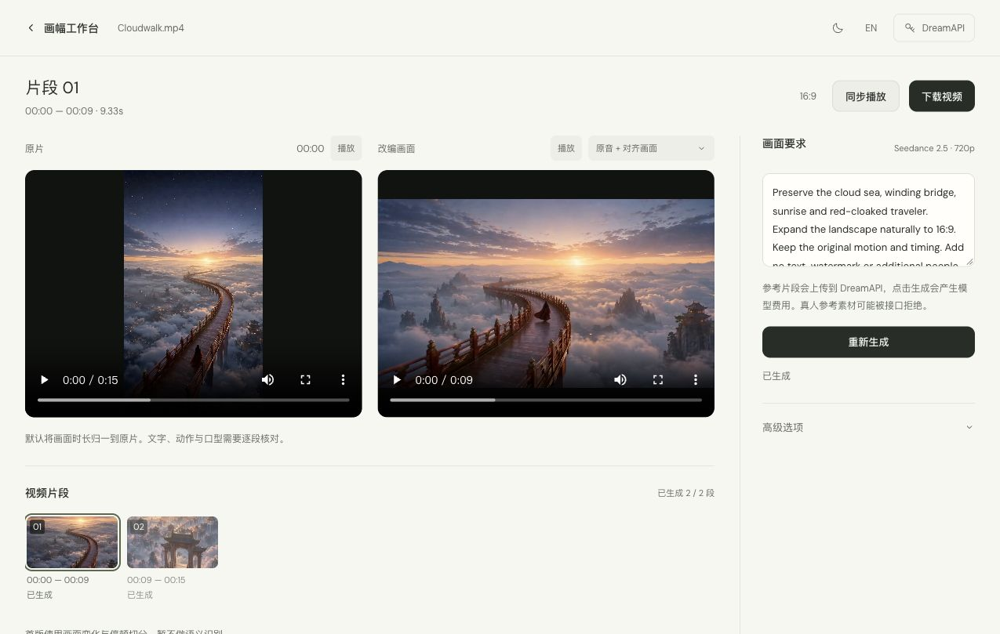
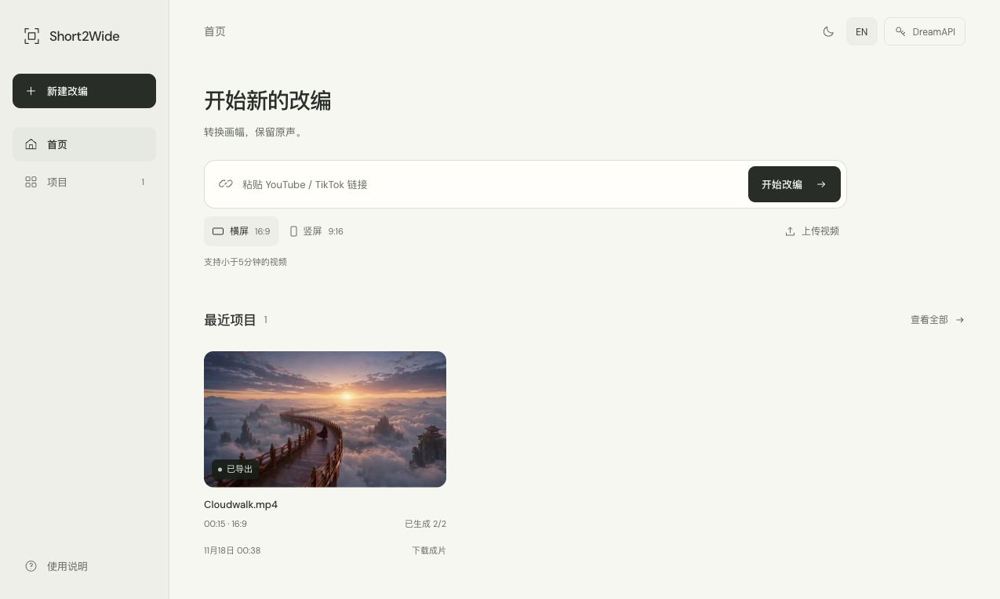

# Short2Wide · 画幅工作台

[English](README.md) · **简体中文**

用 **DreamAPI Seedance 2.5** 改编短视频画幅。在本机导入小于五分钟的视频，逐段生成、左右对照，一次确认后导出，并保留原片声音。

[](https://cdn.jsdelivr.net/gh/Hy-1990/Short2Wide@v0.1.10/docs/assets/short2wide-zh-CN.mp4)

[播放 20 秒演示](https://cdn.jsdelivr.net/gh/Hy-1990/Short2Wide@v0.1.10/docs/assets/short2wide-zh-CN.mp4) · [下载 20 秒短片 · 30 fps](docs/assets/short2wide-zh-CN.mp4) · [流程与边界](docs/showcase.md)

> 需要自备 DreamAPI 密钥。应用在本机运行，生成时会把参考片段传至付费云服务。模型可能拒绝素材，也可能产生文字、动作或时序偏差。

## 主流程

1. **导入**：粘贴公开的 YouTube/TikTok 地址，或上传小于五分钟、512MB 以内的本地视频，选择 16:9 或 9:16。
2. **生成**：按画面变化与音频停顿分段，逐段生成。上传、模型生成、对齐均有明确的动效与用时反馈。
3. **查看**：左右均可单独播放、暂停、拖动进度；“同步播放”每次都让两边从当前片段起点重播。
4. **导出**：所有片段生成完成后，点击一次“确认全部并导出”，无需逐段勾选。

“生成对照音轨”位于生成按钮上方，新片段默认关闭。导出使用原片声音。已生成的片段可展开“手动对齐”调整两个时间点。

## 首页与项目库

左侧导航区分 **首页** 和 **项目**：首页提供导入入口与最近 6 个项目；项目页展示全部项目，支持名称搜索及已导出/未完成筛选。项目增加时自动换行，导航中持续显示总数；点击卡片继续编辑，也可直接下载已有成片。

**新建改编** 会返回并聚焦导入框，**使用说明** 打开操作指南。窄桌面窗口保留侧栏，只有宽度不超过 560px 时改为紧凑的顶部导航；明暗、中英文和 DreamAPI 设置入口保留。



点击项目卡片上的垃圾桶按钮，会弹出包含项目名称的二次确认；点击 **取消** 不作修改。确认后，项目从首页与项目库移除，文件移入本机回收目录。处理中的项目不能删除；删除也不会取消已经提交到云端的生成任务。恢复方式见下文。

## 安装运行

直接使用已有的 **Python 3.10+** 和 pip，Python 直接依赖只有 `requests`、`yt-dlp`，不需要创建或激活环境。

### Windows 10/11

1. 安装 [Python](https://www.python.org/downloads/windows/) 和 [FFmpeg](https://www.gyan.dev/ffmpeg/builds/)。已安装 WinGet 时，可以执行：

   ```powershell
   winget install --id Python.Python.3.12 -e
   winget install --id Gyan.FFmpeg -e
   ```

   安装后重新打开 PowerShell，确认 `python --version`、`ffmpeg -version`、`ffprobe -version` 能运行。如果 Python 只有 `py` 命令，把下面的 `python` 换成 `py -3`。

2. 在 GitHub 点击 **Code → Download ZIP** 下载并解压，或使用 Git 克隆。在解压后的项目文件夹打开 PowerShell，安装一次依赖：

   ```powershell
   python -m pip install -r requirements.txt
   ```

3. 在 PowerShell 中启动：

   ```powershell
   .\start.bat
   ```

   也可以在文件资源管理器中双击 `start.bat`；命令提示符中使用 `start.bat`。脚本检查依赖后启动，支持中文和空格路径，并打印访问地址。双击启动遇到错误会保留提示。不需要 WSL、Bash，也不需要更改 PowerShell 执行策略。

手动安装 FFmpeg 时，把包含 `ffmpeg.exe`、`ffprobe.exe` 的 **bin** 文件夹加入用户 PATH，然后重新打开终端。更换端口：`.\start.bat --port 4179`。

### macOS / Linux

先安装 Python 3.10+ 和 FFmpeg。macOS 使用 Homebrew 时可执行 `brew install python ffmpeg`；Linux 使用发行版的包管理器安装 Python、pip 和 FFmpeg。

```sh
git clone https://github.com/Hy-1990/Short2Wide.git
cd Short2Wide
python3 -m pip install -r requirements.txt
bash start.sh
```

如果 pip 提示 `externally-managed-environment`，使用用户目录安装：

```sh
python3 -m pip install --user --break-system-packages -r requirements.txt
```

这些 [pip 选项](https://pip.pypa.io/en/stable/cli/pip_install/)不修改 pip 全局配置。更换端口：`bash start.sh --port 4179`。

如果终端激活了 conda，脚本会先检查当前 Python；依赖不齐时也会检查已有的 Homebrew Python，使用满足要求的解释器，并显示 `Using Python: ...`。不会切换或修改你的 conda 环境，也不会自动安装依赖。

### 打开并使用

两个平台的启动脚本都会在成功启动后显示实际地址：

```text
Short2Wide
  访问 / Open: http://127.0.0.1:4178/
  按 Ctrl+C 停止 / Press Ctrl+C to stop.
```

浏览器打开 [http://127.0.0.1:4178/](http://127.0.0.1:4178/)，点击右上角 **DreamAPI** 配置密钥，然后粘贴视频链接或上传文件。逐段生成并检查结果，最后点击一次“确认全部并导出”。

使用时保持终端开启；按 `Ctrl+C` 停止。如果 Windows 命令提示符询问是否终止批处理，输入 `Y`。下次只需运行对应平台的启动脚本。端口被占用时，停止旧服务或换一个端口。

更新代码后，先在原终端按 `Ctrl+C` 停止服务，再运行对应平台的启动脚本，并刷新浏览器。项目删除等后端更新需要重启才能生效。

项目已内置 DreamAPI 适配器，正常使用不需要 agent skill、AI 编程工具或 Node。

## 数据与恢复

- 服务仅监听 127.0.0.1，保留 Host/Origin 检查与静态文件白名单。
- 密钥保存在仓库之外的 `~/.config/reframe-studio/dreamapi.json`，macOS/Linux 权限为0600，Windows 继承用户目录权限；不存浏览器、不回传已保存密钥。
- Windows 下，密钥路径为 `%USERPROFILE%\.config\reframe-studio\dreamapi.json`，项目路径为 `%USERPROFILE%\.local\share\reframe-studio\projects\`。
- 项目位于 `~/.local/share/reframe-studio/projects/`，保留旧版本本机项目兼容性。
- 删除的项目移至 `~/.local/share/reframe-studio/trash/`，Windows 对应 `%USERPROFILE%\.local\share\reframe-studio\trash\`。这是应用自己的回收目录，不是系统废纸篓/回收站。恢复时先停止应用，把其中的项目文件夹移回 `projects/`，将文件夹名改回原来的 32 位项目 ID（回收文件夹名的前 32 位，`project.json` 中也有），再启动应用；不要覆盖已有项目。目前没有界面恢复按钮。文件仍占磁盘空间，手动清理回收目录后才释放。
- 首页上传只进入本机。点击生成时才上传参考片段并调用计费模型。
- 结果查询超时或提示 SSL 连接中断时，选中出错的片段，点击 **继续查询同一任务**。应用会使用已保存的任务 ID。若没有任务 ID 且提交状态不明，先到 DreamAPI 控制台核实。
- 对齐失败保留此前可播放的文件，原始素材、模型输出、原音预览和成片分开保存。

## 使用边界

工具不人为限制人数、语言、是否口播或有无音轨，但服务商仍可能限制参考素材。自动分段不是语义识别，生成文字、动作、口型需要自行检查。

默认按总时长归一；两节点只校正线性偏移与速度，不能保证中间全部事件同步。最终使用原文件音轨，编码为AAC以兼容MP4；无音轨输入保持静音。

下载受平台登录、地区与视频可见性影响。生成音频的审核失败不等于原视频有问题；明确需要重试时，可先在生成按钮上方关闭“生成对照音轨”。

## 验证

Node 22+ 仅用于 JavaScript 测试，正常使用不需要。

```sh
node --test tests/test_playback.mjs
python -B -m unittest discover -s tests -t . -q
```

自动测试使用临时素材与替代接口响应，不提交计费任务。[完整验证记录](docs/verification.md)

代码采用 [MIT](LICENSE)，字体、服务和演示媒体分别遵循[第三方说明](THIRD-PARTY.md)。
